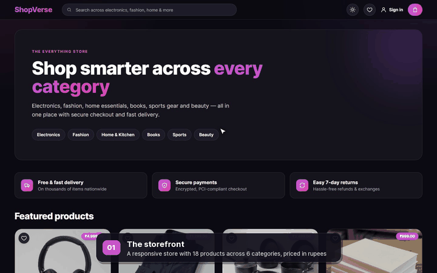

<p align="center"></p>

# 🛒 ShopVerse — Full-Stack E-Commerce Platform

[](https://github.com/Abhishek360007/ShopVerse/actions/workflows/ci.yml)

**[▶ Watch the demo](https://abhishek360007.github.io/ShopVerse/demo/)** · **[Live app](https://shopverse-web-lf22.onrender.com)** · **[Project guide (PDF)](ShopVerse-Project-Guide.pdf)**

[](https://abhishek360007.github.io/ShopVerse/demo/)

ShopVerse is a full-stack e-commerce web application built with **React.js** on the front end and **Spring Boot** on the back end. It covers the full online shopping flow: browsing six categories (Electronics, Fashion, Home & Kitchen, Books, Sports and Beauty), searching, managing a cart, signing in, checking out with a card (Stripe) or cash on delivery, and tracking orders. Prices are in Indian Rupees (₹). It also has an admin panel for managing products and categories.

## ✨ Features

- 🌗 Responsive storefront with light and dark themes (remembers your choice, follows your device by default)
- 🔎 Product search plus category pages with type filters
- 📦 Product pages with size options, stock checks and similar products
- 🛍️ Cart that merges repeat items and respects available stock
- 🔐 Sign-up (optional email verification), login, JWT authentication and Google OAuth2 sign-in
- 💳 Checkout with saved addresses, Stripe card payments or cash on delivery
- 🧾 Order totals calculated on the server from catalog prices
- ❤️ Wishlist: save products, move them to the cart, kept on your account across devices (guest items merge on sign-in)
- 🚚 Order tracking: Placed → Confirmed → Packed → Shipped → Out for delivery → Delivered, with a timestamp for each step, courier tracking number and estimated delivery
- 📜 Order history with cancellation (before shipping) and account settings
- 📊 Admin analytics dashboard: revenue with month-over-month change, monthly sales chart (with table view), best sellers, low-stock alerts and customer insights (new, repeat and top customers)
- 🧾 Admin order management: filter orders, update status with notes and tracking numbers, and see each order's full status history
- 📦 Stock goes down when an order is placed and back up when it is cancelled
- 🛠️ Admin panel (react-admin) for products and categories, restricted to admins
- 🌱 Starter catalog of 18 products across 6 categories, added automatically in versioned batches (products you delete stay deleted)
- 📖 API documentation through Swagger / OpenAPI
- 🐳 One-command setup with Docker Compose
- ✅ Unit tests and GitHub Actions CI for the backend and frontend

## 🛠️ Tech Stack

| Layer          | Technologies                                                   |
| -------------- | -------------------------------------------------------------- |
| Frontend       | React 18, Redux Toolkit, React Router, Tailwind CSS, Axios     |
| Admin          | react-admin                                                    |
| Backend        | Java 25, Spring Boot 4, Spring Security, Spring Data JPA       |
| Database       | PostgreSQL                                                     |
| Authentication | JWT, Google OAuth2                                             |
| Payments       | Stripe                                                         |
| Build Tools    | Maven, npm                                                     |
| DevOps         | Docker, Docker Compose, Nginx, GitHub Actions                  |

## 📁 Project Structure

```
ShopVerse/
├── backend/                         # Spring Boot REST API (package com.shopverse)
│   └── src/main/java/com/shopverse/
│       ├── auth/                    # JWT, OAuth2, registration and user details
│       ├── controllers/             # Product, category, order, address and file upload APIs
│       ├── entities/                # JPA entities
│       ├── services/                # Business logic
│       └── ...
├── UI/                              # React front end
│   └── src/
│       ├── api/                     # API clients
│       ├── components/              # Reusable UI components
│       ├── pages/                   # Pages and the admin panel
│       └── store/                   # Redux store
├── .github/workflows/ci.yml         # CI pipeline
├── docker-compose.yml               # Full stack: PostgreSQL + API + UI
└── ShopVerse.postman_collection.json
```

## 🚀 Getting Started

### Option A: Docker (quickest)

```bash
cp backend/.env.example backend/.env   # then fill in your keys
docker compose up --build
```

| Service  | URL                                           |
| -------- | --------------------------------------------- |
| Frontend | http://localhost:3000                         |
| API      | http://localhost:8080                         |
| Swagger  | http://localhost:8080/swagger-ui/index.html   |

PostgreSQL runs inside Docker, so you don't need it installed locally.

### Option B: Run locally

#### Prerequisites

- Java 25+
- Node.js 18+ and npm
- PostgreSQL

#### 1. Backend

Set these environment variables. `backend/.env.example` lists them:

| Variable                       | Description                          |
| ------------------------------ | ------------------------------------ |
| `DB_HOST`                      | PostgreSQL host                      |
| `DB_PORT` / `DB_NAME`          | Port (default `5432`) and database name (default `shopverse`) |
| `DB_SSLMODE`                   | `prefer` (default) locally, `require` for hosted databases like Neon |
| `DB_USER` / `DB_PASSWORD`      | Database credentials                 |
| `MAIL_USERNAME`                | Gmail address used to send emails    |
| `MAIL_PASSWORD`                | Gmail app password                   |
| `JWT_KEY`                      | Base64 secret for signing JWTs (`openssl rand -base64 48`) |
| `GOOGLE_OAUTH2_CLIENT_ID`      | Google OAuth2 client ID              |
| `GOOGLE_OAUTH2_CLIENT_SECRET`  | Google OAuth2 client secret          |
| `STRIPE_SECRET`                | Stripe secret key                    |
| `FILE_ZONE`, `CDN_KEY`, `CDN_HOST` | Storage settings for file uploads |
| `FRONTEND_URL`                 | Frontend URL for OAuth2 redirects (default `http://localhost:3000`) |
| `ADMIN_EMAIL`                  | The account with this email gets admin access |
| `CORS_ALLOWED_ORIGINS`         | Sites allowed to call the API, comma-separated (default: `FRONTEND_URL`) |
| `SEED_DATA`                    | Load the starter catalog into an empty database (default `true`) |
| `EMAIL_VERIFICATION`           | Require an email code on sign-up (default `true`; set `false` if no mail server) |

Then run:

```bash
cd backend
./mvnw spring-boot:run
```

The API runs at `http://localhost:8080`. Swagger UI is at `http://localhost:8080/swagger-ui/index.html`.

#### Admin access

Set `ADMIN_EMAIL` to your email, then sign up with that email (or restart the backend if the account already exists). Your account page will then show **Manage store**, which opens the admin panel at `/admin`. The admin panel has a sales dashboard, an **Orders** page for updating order status, and pages for products and categories.

> Without `REACT_APP_STRIPE_KEY` the card option is turned off at checkout and customers can still pay with cash on delivery.

#### 2. Frontend

Optionally create `UI/.env` from `UI/.env.example`:

| Variable                  | Description                                    |
| ------------------------- | ---------------------------------------------- |
| `REACT_APP_API_BASE_URL`  | Backend URL (default `http://localhost:8080`)  |
| `REACT_APP_STRIPE_KEY`    | Stripe publishable key                         |
| `REACT_APP_CDN_URL`       | Base URL for uploaded product images           |
| `REACT_APP_GOOGLE_LOGIN`  | Set to `true` to show “Continue with Google”   |

```bash
cd UI
npm install
npm start
```

The app opens at `http://localhost:3000`.

## ☁️ Deploy (free): Neon + Render

The database runs on [Neon](https://neon.tech) (free PostgreSQL, no expiry) and the API and storefront run on [Render](https://render.com) using the included [Blueprint](render.yaml).

**1. Create the database on Neon**
1. Sign in at [neon.tech](https://neon.tech) and create a project (region: Singapore / `ap-southeast-1`).
2. Click **Connect** and note the **host**, **database**, **user** and **password**.

**2. Deploy on Render**
1. Sign in at [render.com](https://render.com) with GitHub.
2. Click **New → Blueprint** and select the **ShopVerse** repository.
3. Fill in `DB_HOST`, `DB_NAME`, `DB_USER`, `DB_PASSWORD` (from Neon) and `ADMIN_EMAIL` (your admin email), then click **Apply**.
4. Wait for **shopverse-api** and **shopverse-web** to go live (the first build takes about 10 minutes).
   If Render gave your services different addresses, put them in `render.yaml` (`FRONTEND_URL` = the shopverse-web address, `REACT_APP_API_BASE_URL` = the shopverse-api address) and push.
5. Open the **shopverse-web** URL, sign up with your `ADMIN_EMAIL`, and you'll see **Manage store** on your account page.

The tables and starter catalog are created automatically on first start. On Render's free plan the API sleeps after 15 minutes without visitors, so the first page load after a break can take about a minute.

Card payments, Google sign-in, emails and image uploads are off by default. To turn one on, replace its `not-configured` values in **shopverse-api → Environment** (for Google sign-in, also set `REACT_APP_GOOGLE_LOGIN=true` on **shopverse-web**; for card payments, set `REACT_APP_STRIPE_KEY`).

## 🧪 Testing

```bash
cd backend && ./mvnw test                  # backend unit tests
cd UI && npm test -- --watchAll=false      # frontend unit tests
```

GitHub Actions runs both test suites and a production build on every push and pull request to `main`.

### API Testing

Import `ShopVerse.postman_collection.json` into Postman. Set `baseUrl`, run **Auth → Login** (as a shopper) and **Auth → Login as admin**, and the tokens are saved for the other requests automatically.

## 🙏 Credits

Product photos are CC0 / public domain; sources are listed in [UI/public/images/products/CREDITS.md](UI/public/images/products/CREDITS.md).

## 👤 Author

**Abhishek Raj** — [GitHub @Abhishek360007](https://github.com/Abhishek360007)
